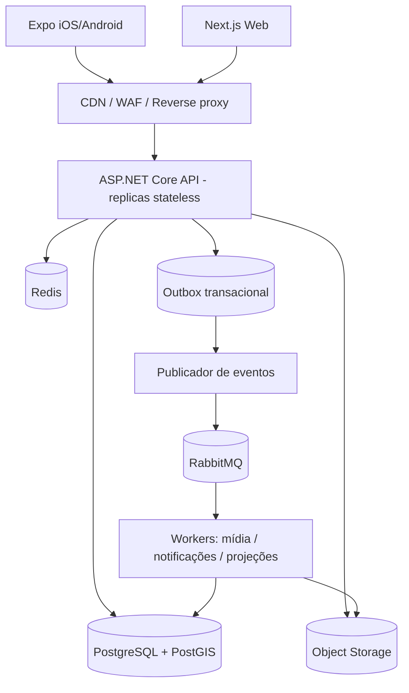

# Applada — Especificação de Arquitetura v1.0

**Data:** 13/11/2026  
**Status:** proposta técnica para validação; não constitui implementação nem benchmark de capacidade.  
**Decisões de produto:** lançamento nacional (Brasil); rede social completa; infraestrutura em VPS; mobile React Native/Expo; web Next.js; backend ASP.NET Core/.NET 10.

## 1. Princípios e arquitetura escolhida

**Escolha:** monólito modular de implantação independente dos workers, orientado a eventos, com extração incremental de serviços conforme métricas. Escalabilidade horizontal da API; banco relacional como fonte de verdade; mídia em object storage; processos demorados em fila. Não utilizar microservices para cada entidade nem Kubernetes no lançamento.

**Princípios:** módulos por domínio e não por camada técnica; ownership exclusivo de tabelas por módulo; sem acesso direto ao repositório de outro módulo; contratos públicos explícitos; operações críticas transacionais; integração assíncrona com transactional outbox; idempotência no consumo; observabilidade e testes desde a fundação.



## 2. Mapa de módulos e ownership

| Módulo | Responsabilidade | Entidades/tabelas principais | Eventos de saída |
|---|---|---|---|
| Identity | identidade, sessões, credenciais, recuperação | `identity.users`, `identity.external_logins`, `identity.refresh_sessions` | `UserRegistered` |
| Profiles | perfis, preferências, bloqueios e conexões | `profiles.player_profiles`, `profiles.follows`, `profiles.blocks` | `ProfileUpdated`, `UserFollowed` |
| Communities | grupos, membros, funções e convites | `communities.groups`, `communities.memberships`, `communities.invitations` | `GroupMemberJoined` |
| Matches | partidas, capacidade, lista de espera, presença | `matches.matches`, `matches.registrations`, `matches.waitlist_offers`, `matches.attendance` | `MatchCreated`, `SpotConfirmed`, `SpotReleased` |
| Teams | times, convocações, campeonatos, rodadas | `teams.teams`, `teams.roster`, `teams.tournaments`, `teams.fixtures` | `MatchResultApproved` |
| Social | posts, feed, curtidas, comentários, denúncias de post | `social.posts`, `social.comments`, `social.reactions`, `social.feed_entries` | `PostPublished`, `PostDeleted` |
| Media | upload, metadados, transcodificação, moderação de mídia | `media.assets`, `media.variants`, `media.upload_sessions` | `AssetReady`, `AssetRejected` |
| Statistics | gols, assistências, reputação e rankings | `statistics.match_events`, `statistics.player_stats`, `statistics.ranking_snapshots` | `StatsUpdated` |
| Payments | rateio, cobranças, recibos, conciliação | `payments.charges`, `payments.contributions`, `payments.provider_events` | `PaymentConfirmed` |
| Notifications | push, inbox, preferências, entregas | `notifications.devices`, `notifications.messages`, `notifications.deliveries` | `NotificationDispatched` |
| Discovery | busca por região e coordenadas, sugestões | `discovery.venues`, `discovery.search_projection` | `VenuePublished` |
| Trust & Safety | denúncias, moderação, sanções e auditoria | `trust.reports`, `trust.moderation_cases`, `trust.actions`, `trust.audit_log` | `ContentRestricted`, `AccountSuspended` |

**Dependências:** Matches consulta a identidade do usuário por identificador/contrato, não por `JOIN` sobre tabela de Identity; Social recebe `AssetReady` e mantém referência a mídia; Notifications apenas consome eventos. Views transversais são projeções de leitura, não acesso arbitrário às tabelas de outros módulos. Na primeira versão, os módulos podem compartilhar o mesmo cluster PostgreSQL, mas cada um possui schema e migrações próprias.

## 3. Modelo de dados lógico

**IDs:** UUIDv7 ou identificador global ordenável compatível com .NET/EF Core; `created_at`/`updated_at` em UTC; `deleted_at` quando aplicável; timestamps e índices adequados. PII isolada, retenção específica e exclusão/anonimização conforme finalidade legal.

**Relações centrais:** `users 1:1 player_profiles`; `groups N:M users via memberships`; `matches N:1 groups?`, `matches N:1 venues?`; `matches N:M users via registrations`; `posts N:1 authors`, `posts N:1 matches?`; `posts N:M assets via post_assets`; `comments N:1 posts`; `reactions` unicidade `(actor_id, target_type, target_id, reaction_type)`; `follows` unicidade `(follower_id, followed_id)`; `charges N:1 matches`, `contributions N:1 charges`.

### Índices e integridade críticos

- `matches.registrations`: `UNIQUE(match_id,user_id)`; status com enum controlado; índice `(match_id,status,created_at)`.
- `matches.matches`: `capacity > 0`, `starts_at < ends_at`, timezone IANA do local e `version` para concorrência otimista.
- Confirmação da última vaga: transação no PostgreSQL com lock na linha da partida (`SELECT ... FOR UPDATE`) ou atualização condicional atômica do contador; estado de ocupação e registro alterados na mesma transação; retry delimitado. **Não confiar no Redis para alocação definitiva.**
- `social.posts`: índice `(author_id,created_at DESC,id DESC)` e visibilidade; `feed_entries`: índice `(recipient_id,ranked_at DESC,post_id DESC)`.
- `media.assets`: estado `pending|processing|ready|rejected|deleted`, proprietário, tamanho, MIME validado, hash e chave no storage; nunca salvar binário no PostgreSQL.
- `discovery.venues`: coluna geográfica PostGIS `geography(Point,4326)` com GiST e parâmetros de raio; evitar exposição desnecessária de localização pessoal.
- `notifications.deliveries` e `payments.provider_events`: chaves de deduplicação. `integration.outbox` contém `event_id`, `type`, `version`, `payload`, `occurred_at`, `published_at`; consumidor mantém inbox ou tabela de processamento idempotente.

## 4. Contratos HTTP (v1)

**Base:** `/api/v1`; JSON UTF-8; OpenAPI como fonte de contrato; auth OAuth2/OIDC PKCE para clientes, bearer access token curto; IDs opacos; paginação cursor-based; `Idempotency-Key` nas escritas repetíveis sensíveis; `ETag/If-Match` em alterações concorrentes quando aplicável. Problemas retornam `application/problem+json` RFC 9457.

| Método e rota | Finalidade | Observações |
|---|---|---|
| `GET /me` | identidade e perfil básico | autenticado |
| `PATCH /me/profile` | editar perfil | validação e política de privacidade |
| `POST /groups` / `GET /groups/{id}` | criar / visualizar grupo | papéis owner/admin/member |
| `POST /matches` / `GET /matches/{id}` | criar / consultar partida | timezone, local, capacidade, regras |
| `POST /matches/{id}/registrations` | confirmar ou entrar em espera | idempotente; transação concorrente |
| `DELETE /matches/{id}/registrations/me` | cancelar participação | promove lista de espera por workflow |
| `POST /matches/{id}/results` | propor resultado | aprovação por organizador/regras |
| `GET /feed?cursor=...&limit=...` | feed personalizado | limite máximo, cursor estável |
| `POST /posts` / `GET /posts/{id}` | publicar / consultar | assets devem estar `ready` |
| `POST /posts/{id}/comments` | comentar | rate limit e moderação |
| `POST /media/uploads` | criar sessão de upload | devolve URL assinada curta e limites |
| `POST /media/uploads/{id}/complete` | concluir upload | valida objeto, enfileira processamento |
| `GET /discover/matches?lat=...&lon=...&radiusKm=...` | descobrir jogos | somente partidas públicas elegíveis |
| `POST /reports` | reportar conteúdo/usuário | abuso e auditabilidade |
| `GET /notifications?cursor=...` | caixa de notificações | sem polling agressivo |

Exemplo de criação de partida:

```json
{
  "groupId": "018f-example-id",
  "title": "Pelada de quinta",
  "startsAt": "2026-11-19T19:00:00-04:00",
  "timeZone": "America/Campo_Grande",
  "durationMinutes": 90,
  "capacity": 20,
  "visibility": "public",
  "venueId": "018f-example-venue"
}
```

Resposta ilustrativa `201 Created`: `{"id":"018f-example-match","status":"scheduled","confirmedCount":0,"capacity":20}`. IDs são apenas exemplos, não UUIDs válidos completos.

### Eventos de integração

Envelope versionado: `eventId`, `eventType`, `schemaVersion`, `aggregateId`, `occurredAt`, `correlationId`, `payload`. Exemplos:

- `matches.spot-confirmed.v1` → Notifications (push), Statistics (eventual), Social (eventual).
- `media.asset-ready.v1` → Social habilita publicação, Notifications atualiza status.
- `social.post-published.v1` → feed projections, moderação assíncrona e alertas.
- `payments.payment-confirmed.v1` → Matches/organizador atualiza projeção financeira.

Eventos são **at-least-once**: consumidores precisam ser idempotentes, tolerar reordenação e ter DLQ. Não existe transação global entre módulos. O outbox garante atomicidade entre mudança local e registro da intenção de publicação; não garante entrega exatamente uma vez.

## 5. Feed e mídia social

**Feed MVP:** cronologia reversa de seguidos e grupos, ranking leve opcional; paginação por cursor, filtros de privacidade e bloqueios em toda leitura. `feed_entries` é projeção reconstruível; começar com fan-out-on-read e materializações seletivas para autores/grupos muito ativos. Não inserir um registro por seguidor indiscriminadamente: contas de grande alcance podem gerar explosão de writes. Métricas determinam fan-out híbrido e eventual serviço Social separado.

**Mídia:** app solicita upload; API autoriza e gera URL assinada; cliente envia diretamente ao storage; callback/complete valida objeto, magic bytes, tamanho, duração, antivírus se disponível, status/moderação; worker produz miniaturas, variantes e vídeo HLS/MP4; CDN distribui arquivos públicos autorizados. Para mídia privada, usar URLs assinadas/cookies de acesso e jamais tornar bucket privado público por conveniência. Limites iniciais configuráveis por conta e política de retenção. FFmpeg workers com CPU/RAM limitadas, isolamento do processo e fila própria.

## 6. Segurança, privacidade, abuso e LGPD

- OIDC/OAuth2 com PKCE e provedor de identidade consolidado; acesso curto, refresh rotativo e revogável, armazenamento seguro do token em mobile, cookies HttpOnly/SameSite com CSRF apropriado para web; MFA para administradores.
- Autorização **por objeto**: proprietário, administrador do grupo, participante, seguidores e público não são equivalentes. Negar por padrão e testar IDOR/BOLA em todos os endpoints.
- TLS, WAF, rate limits em IP/conta/dispositivo, proteção a credential stuffing, CORS restritivo, CSP web, sanitização e validação, secrets fora do repositório, rotação e logs sem tokens/PII sensíveis.
- Upload em storage segregado, MIME real, tamanho e resolução máximos, transcoding isolado, URLs assinadas, prevenção de conteúdo ilegal, denúncias e revisão humana.
- LGPD: política de privacidade, bases legais por finalidade, consentimentos quando cabíveis, transparência para geolocalização e publicação de imagem, portabilidade/eliminação quando aplicável, retenção e trilha de auditoria. Planejar menores de idade e proteção de dados desde o produto; obter revisão jurídica antes do lançamento nacional.
- Segurança financeira: não armazenar dados de cartão; terceirizar cobrança para PSP; verificar assinatura de webhook, valor, moeda, recebedor e evento idempotente; conciliação e antifraude. Nunca equiparar retorno do navegador a pagamento confirmado.
- CI: SAST, análise de dependências/containers, secret scanning, testes de autorização, backup-restore drill e revisão humana para mudanças críticas.

## 7. Infraestrutura VPS — topologia por maturidade

### Ambiente de desenvolvimento

Docker Compose/Aspire: API, PostgreSQL/PostGIS, Redis, RabbitMQ, object storage compatível S3 local, workers e collector OpenTelemetry. Ambientes isolados; dados sintéticos. Secrets via mecanismo seguro e `.env` não versionado.

### Produção inicial (mínimo robusto)

- DNS + CDN/WAF externo; reverse proxy (Caddy/Traefik ou Nginx) com TLS e headers corretos.
- **2 VPS de aplicação**, com containers stateless da API/Next.js e workers limitados; balancer/edge com failover; distribuição em provedores/zonas distintas se possível e testado.
- **PostgreSQL gerenciado ou VPS dedicada de banco** com volume persistente, PITR/WAL archival, backup externo criptografado e testes de restauração; réplica/failover somente após desenho e exercícios de operação. Uma única VPS de banco permanece SPOF.
- Redis com políticas de memória e eviction definidas; RabbitMQ com mensagens duráveis e observação de DLQ; seus HA/failover são decisões de custo separadas.
- Object storage S3 compatível externo à VPS, versionamento/lifecycle e CDN; **não** armazenar a biblioteca de vídeos apenas no disco da VPS.
- Observabilidade: OpenTelemetry Collector + Prometheus/Grafana + Loki/tempo ou stack equivalente; alertas em p95/p99, 5xx, fila, lag, CPU/RAM, I/O, disco, backups e taxa de upload.
- CI/CD: build imutável OCI, SBOM, scans, migrações expansivas/compatíveis antes do deploy, rollout com healthcheck e rollback de aplicativo. Banco não tem rollback trivial: usar expand-contract.

**Nota:** duas VPS de app não tornam a solução altamente disponível se banco, storage, proxy ou mensageria tiverem ponto único de falha. Orçamento e metas de RPO/RTO determinarão redundância real.

### Capacidade e evolução

Definir SLO inicial proposto: disponibilidade mensal 99,9% da API, p95 de consultas simples no servidor abaixo de 300 ms nas condições de teste definidas; separar SLO de upload e processamento de vídeo. Metas não são garantias. Antes da produção: k6 testando inscrições simultâneas na última vaga, mix de leitura/escrita, login, feed e upload; exercícios de restauração e queda de nó. Considerar extração de Media e Feed primeiro quando suas métricas demonstrarem necessidade. Medir DAU/MAU, concorrência máxima, RPS, postagens por minuto, GB/dia, minutos de vídeo/dia, egress e tamanho médio de feed.

## 8. Solution .NET proposta

```text
applada/
  apps/
    web/                       # Next.js
    mobile/                    # Expo
  backend/
    Applada.slnx
    src/
      Applada.Api/             # Controllers/Minimal APIs, composition root
      Applada.AppHost/         # Aspire (desenvolvimento)
      Applada.ServiceDefaults/ # OTel/health/resilience
      BuildingBlocks/
        Applada.BuildingBlocks.Contracts/
        Applada.BuildingBlocks.Persistence/
        Applada.BuildingBlocks.Messaging/
      Modules/
        Identity/{Domain,Application,Infrastructure,Api}/
        Profiles/{Domain,Application,Infrastructure,Api}/
        Communities/{Domain,Application,Infrastructure,Api}/
        Matches/{Domain,Application,Infrastructure,Api}/
        Teams/{Domain,Application,Infrastructure,Api}/
        Social/{Domain,Application,Infrastructure,Api}/
        Media/{Domain,Application,Infrastructure,Api}/
        Statistics/{Domain,Application,Infrastructure,Api}/
        Payments/{Domain,Application,Infrastructure,Api}/
        Notifications/{Domain,Application,Infrastructure,Api}/
        Discovery/{Domain,Application,Infrastructure,Api}/
        Trust/{Domain,Application,Infrastructure,Api}/
      Workers/
        Applada.Workers.Media/
        Applada.Workers.Notifications/
        Applada.Workers.Projections/
    tests/
      Unit/
      Architecture/
      Integration/
      Contract/
      EndToEnd/
  infra/
    compose/
    reverse-proxy/
    observability/
    migrations/
    deploy/
  docs/
    adr/
    api/
    threat-model/
    runbooks/
```

**Dependências permitidas:** Domain sem dependência de Infrastructure/Api; Application depende de Domain e contratos; Infrastructure implementa portas; Api compõe e expõe endpoints; módulos só se referenciam por contratos publicados; arquitetura validada automaticamente com testes de dependências. Evitar abstrações genéricas excessivas (`GenericRepository<T>`, mediadores sem benefício mensurável). EF Core `DbContext` por módulo e migration própria. Considere modularidade em projetos separados por camada nos módulos maiores; nos menores, pastas internas podem reduzir ruído sem sacrificar regras.

## 9. Roadmap com critérios de aceite

| Etapa | Entregas | Critério de saída |
|---|---|---|
| 0 — Discovery e ADRs (1–2 semanas) | jornadas, personas, riscos, ADRs, orçamento, SLO/RPO/RTO | fluxos e domínio validados; decisão de auth/PSP/storage |
| 1 — Fundação (2–4 semanas) | monorepo, CI, Aspire/Compose, auth, observabilidade, migrations, segurança base | pipeline verde; ambiente reproduzível; restore de backup |
| 2 — Peladas MVP (4–6 semanas) | grupos, partidas, vagas, espera, convites, presença, descoberta | teste de concorrência não excede capacidade; E2E web/mobile |
| 3 — Social e mídia (4–6 semanas) | posts, feed, comentários, fotos, vídeos, upload direto, moderação | acessos privados protegidos; processamento resiliente; testes de carga |
| 4 — Estatísticas e pagamentos (3–5 semanas) | placares aprovados, ranking, rateio, PSP, webhooks | idempotência, reconciliação e auditoria testadas |
| 5 — Beta/escala (3–4 semanas) | piloto, métricas, antifraude, LGPD, testes, DR, lojas | SLO observado, incident runbook, revisão de segurança |

Estimativas indicativas para equipe experiente de 3–5 pessoas com design/QA e escopo controlado; não são prazo contratado. Social com vídeo, moderação e finanças pode ampliar sensivelmente o cronograma. Prioridade de release: **primeiro organizar uma pelada perfeitamente**, depois expandir social e pagamentos.

## 10. Decisões em aberto e ADRs

1. **Auth:** Keycloak autogerido vs provedor gerenciado; responsabilidade operacional e custo.
2. **VPS:** provedor, regiões, orçamento mensal, volumes, redundância e política de backup.
3. **Storage/CDN:** compatibilidade S3, egress, processamento e proteção da mídia privada.
4. **PSP:** Pix, cobrança por partida, taxa da plataforma, split, reembolso e compliance.
5. **Moderação e menores:** idade mínima, privacidade por padrão, fluxo de denúncia e SLA de resposta.
6. **Visibilidade:** público, grupo, convite; localização aproximada vs exata; consentimento de fotos.
7. **Operação:** equipe on-call, metas RPO/RTO, retenção, custo de vídeo e monitoramento.
8. **Escala real:** metas DAU/MAU/RPS, vídeos por dia e orçamento por usuário ativo.

## 11. Primeira sequência de implementação

1. Registrar ADR-001 (monólito modular), ADR-002 (PostgreSQL/PostGIS), ADR-003 (mídia S3), ADR-004 (OIDC), ADR-005 (outbox + RabbitMQ), ADR-006 (deploy VPS).
2. Inicializar monorepo, solution, checks de arquitetura, CI, ambiente local e telemetria.
3. Implementar Identity, Profiles, Communities, Matches com teste concorrente da última vaga.
4. Entregar web e Expo para criação/entrada em peladas; testar jornada real com usuários.
5. Expandir Media, Social, Trust, Notifications e somente então pagamento/estatísticas avançadas.

**Fontes técnicas de referência:** Microsoft Learn — [arquiteturas web](https://learn.microsoft.com/en-us/dotnet/standard/modern-web-apps-azure-architecture/common-web-application-architectures), [microservices](https://learn.microsoft.com/en-us/dotnet/architecture/microservices/architect-microservice-container-applications/microservices-architecture), [Aspire](https://learn.microsoft.com/en-us/dotnet/aspire/architecture/overview), [OpenTelemetry](https://learn.microsoft.com/en-us/dotnet/core/diagnostics/observability-with-otel), [rate limiting](https://learn.microsoft.com/en-us/aspnet/core/performance/rate-limit), [cache](https://learn.microsoft.com/en-us/aspnet/core/performance/caching/overview).
